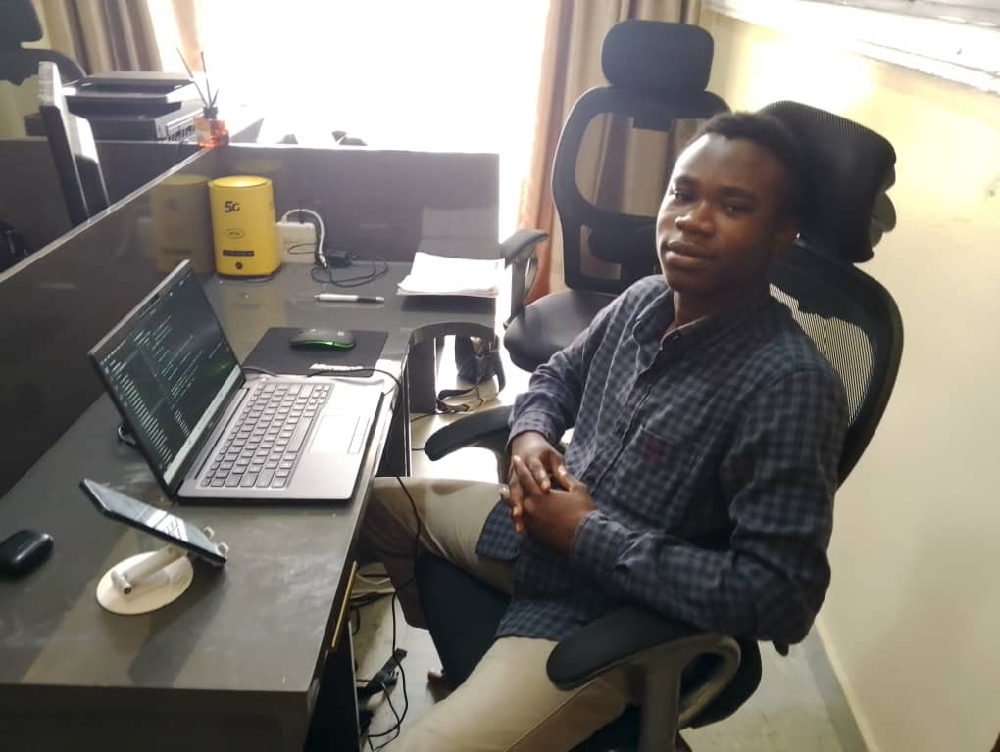

  <!-- Header Banner -->
  

  <!-- Dynamic Typing SVG -->
  

   

  <!-- Quick Action Badges -->
  

    
    
    
    
    
  

---

### 👨‍💻 About Me

<table>
  <tr>
    <td width="24%" align="center" valign="middle">
      
       
      <b>Jeremiah Alao</b>
       
      🤖 Robotics & AI Engineer
       
      📍 Lagos, Nigeria
        
      
    </td>
    <td width="76%" valign="top">
      

        I design and build <b>intelligent machines</b> — from bare-metal embedded firmware on <b>Arduino and ESP32</b>, to <b>ROS 2</b> robotic manipulators and production-grade <b>machine learning backends</b>.
      

      

        With <b>37+ public repositories</b> spanning autonomous mobile robots, computer-vision pipelines, predictive-maintenance engines, and IoT infrastructure, I bridge the physical-digital divide to turn complex engineering problems into working hardware and software.
      

      <ul>
        <li>🔭 <b>Active Focus:</b> Advanced Robotics Modelling & Control (ROS 2 Humble, Kinematics, Gazebo) & AI Backend Engineering.</li>
        <li>🦾 <b>Flagship Robotic Arm:</b> Architecting <b><a href="https://github.com/youniquestar/astari-selah">Astari Selah</a></b> — a 5-DOF articulated robot combining FreeCAD CAD, ESP32 FreeRTOS firmware, and ROS 2 kinematics.</li>
        <li>📡 <b>Wireless Telemetry:</b> Sub-5ms low-latency peer-to-peer <b>ESP-NOW</b> motion control networks.</li>
        <li>🧠 <b>Predictive AI:</b> Author of <b><a href="https://github.com/youniquestar/pulse-ai">Pulse AI</a></b> (real-time machinery anomaly diagnosis with FastAPI) and healthcare triage systems.</li>
        <li>💬 <b>Ask Me About:</b> Robotics, Kinematics, Firmware Co-Design, Embedded C++, Python, and Chess ♟️.</li>
      </ul>
    </td>
  </tr>
</table>

---

### 📊 GitHub Insights & Visual Analytics

  <table border="0">
    <tr>
      <td align="center" valign="middle">
        
      </td>
      <td align="center" valign="middle">
        
      </td>
    </tr>
  </table>

   

  

---

### 🛠️ Skills & Technologies

#### 🤖 Robotics & Simulation

  
  
  
  
  
  
  

#### ⚡ Embedded Systems & IoT Firmware

  
  
  
  
  
  
  

#### 💻 Programming Languages

  
  
  
  
  
  

#### 🧠 AI, Machine Learning & Backend

  
  
  
  
  
  
  

#### 📐 CAD, Prototyping & Fabrication

  
  
  
  

#### 🛠️ Developer Tools & Environments

  
  
  
  
  
  

---

### 🚀 Featured Engineering Projects

<table>
  <thead>
    <tr>
      <th width="35%">Project</th>
      <th width="45%">Description</th>
      <th width="20%">Tech Stack</th>
    </tr>
  </thead>
  <tbody>
    <tr>
      <td>
        <b>🦾 <a href="https://github.com/youniquestar/astari-selah">Astari Selah — 5-DOF Robotic Arm</a></b>
         
        Open-source articulated robotic manipulator
      </td>
      <td>
        Full-stack robotic arm from mechanical CAD in <b>FreeCAD</b>, to real-time bare-metal <b>ESP32 FreeRTOS</b> firmware, to <b>ROS 2 Humble</b> kinematics and Gazebo simulation digital twin.
         
        🔗 <a href="https://github.com/youniquestar/astari-selah"><b>GitHub Repo</b></a> · <a href="https://youniquestar.github.io/projects/astari-selah/"><b>Read Project Post</b></a>
      </td>
      <td>
        <code>ROS 2</code> 
        <code>ESP32</code> 
        <code>FreeRTOS</code> 
        <code>C++</code> 
        <code>FreeCAD</code>
      </td>
    </tr>
    <tr>
      <td>
        <b>📡 <a href="https://github.com/youniquestar/esp32-wireless-robotics-controller">ESP32 Wireless Robotics Controller</a></b>
         
        Low-latency peer-to-peer telemetry
      </td>
      <td>
        Ultra-low-latency (<b>sub-5ms</b>) wireless telemetry and motion controller for multi-DOF robotic arms using Espressif's <b>ESP-NOW</b> protocol with core v3.0+ event-driven callbacks.
         
        🔗 <a href="https://github.com/youniquestar/esp32-wireless-robotics-controller"><b>GitHub Repo</b></a> · <a href="https://youniquestar.github.io/projects/esp32-wireless-controller/"><b>Read Project Post</b></a>
      </td>
      <td>
        <code>ESP32</code> 
        <code>ESP-NOW</code> 
        <code>C++</code> 
        <code>FreeRTOS</code> 
        <code>PWM Servos</code>
      </td>
    </tr>
    <tr>
      <td>
        <b>⚙️ <a href="https://github.com/youniquestar/pulse-ai">Pulse AI — Predictive Maintenance Engine</a></b>
         
        Industrial sensor anomaly detection & ML pipeline
      </td>
      <td>
        Production-grade machine learning pipeline and <b>FastAPI</b> backend that monitors industrial milling machine health across 10,000 sensor telemetry records, predicting failures and diagnosing root causes.
         
        🔗 <a href="https://github.com/youniquestar/pulse-ai"><b>GitHub Repo</b></a> · <a href="https://youniquestar.github.io/projects/pulse-ai/"><b>Read Project Post</b></a>
      </td>
      <td>
        <code>Python</code> 
        <code>FastAPI</code> 
        <code>Scikit-learn</code> 
        <code>Pandas</code> 
        <code>REST API</code>
      </td>
    </tr>
    <tr>
      <td>
        <b>🤖 <a href="https://github.com/youniquestar/arduino-human-following-robot">Autonomous Human-Following Robot</a></b>
         
        Sensor-fused differential-drive carriage
      </td>
      <td>
        Differential-drive autonomous mobile robot that detects, tracks, and follows human targets using <b>HC-SR04 ultrasonic distance ranging</b> and dual <b>infrared tracking sensors</b> with adaptive motor kinematics.
         
        🔗 <a href="https://github.com/youniquestar/arduino-human-following-robot"><b>GitHub Repo</b></a> · <a href="https://youniquestar.github.io/projects/human-following-robot/"><b>Read Project Post</b></a>
      </td>
      <td>
        <code>Arduino</code> 
        <code>C++</code> 
        <code>Ultrasonic</code> 
        <code>IR Sensors</code> 
        <code>L298N</code>
      </td>
    </tr>
    <tr>
      <td>
        <b>🏥 <a href="https://github.com/youniquestar/ai_health_partner">AI Health Partner — Triage Engine</a></b>
         
        Intelligent conversational healthcare triage
      </td>
      <td>
        Automated clinical triage and patient check-up conversational engine built to reduce healthcare strain with empathetic pre-screening and daily treatment follow-up.
         
        🔗 <a href="https://github.com/youniquestar/ai_health_partner"><b>GitHub Repo</b></a> · <a href="https://youniquestar.github.io/projects/ai-health-partner/"><b>Read Project Post</b></a>
      </td>
      <td>
        <code>Python</code> 
        <code>NLP</code> 
        <code>State Machines</code> 
        <code>Healthcare Tech</code> 
        <code>REST API</code>
      </td>
    </tr>
    <tr>
      <td>
        <b>💧 <a href="https://github.com/youniquestar/arduino-smart-irrigation-system">Smart Irrigation Controller</a></b>
         
        Environment-aware automated agricultural system
      </td>
      <td>
        Automated irrigation controller combining soil moisture sensing, <b>DHT11</b> microclimate telemetry, ambient light gating, water pump relay control, and a servo-swept sprinkler mechanism.
         
        🔗 <a href="https://github.com/youniquestar/arduino-smart-irrigation-system"><b>GitHub Repo</b></a> · <a href="https://youniquestar.github.io/projects/smart-irrigation/"><b>Read Project Post</b></a>
      </td>
      <td>
        <code>Arduino</code> 
        <code>C++</code> 
        <code>Soil Moisture</code> 
        <code>DHT11</code> 
        <code>Relay Actuation</code>
      </td>
    </tr>
  </tbody>
</table>

---

### 📦 Open-Source Hardware & Embedded Ecosystem (30+ Repos)

  
<b>Click to expand Jeremiah's complete robotics & embedded repository catalogue</b>

   

| Category | Repository | Description |
| :--- | :--- | :--- |
| <b>Autonomous Mobile Robots</b> | <a href="https://github.com/youniquestar/arduino-obstacle-avoidance-robot">arduino-obstacle-avoidance-robot</a> | Autonomous mobile robot with servo-actuated ultrasonic radar scanning |
| | <a href="https://github.com/youniquestar/arduino-line-following-obstacle-robot">arduino-line-following-obstacle-robot</a> | Dual-servo pan-tilt ultrasonic radar with IR optical line-tracking |
| | <a href="https://github.com/youniquestar/arduino-human-following-robot">arduino-human-following-robot</a> | Differential-drive human follower with dual IR and ultrasonic fusion |
| <b>Assistive & Smart Infrastructure</b> | <a href="https://github.com/youniquestar/arduino-smart-walking-stick">arduino-smart-walking-stick</a> | Assistive mobility cane for the visually impaired with acoustic/haptic cues |
| | <a href="https://github.com/youniquestar/arduino-rfid-barrier-gate">arduino-rfid-barrier-gate</a> | 13.56MHz MFRC522 RFID access control with metal-gear servo gate |
| | <a href="https://github.com/youniquestar/arduino-touchless-automatic-dustbin">arduino-touchless-automatic-dustbin</a> | Contactless hygienic trash can with ultrasonic sensing & SG90 actuation |
| | <a href="https://github.com/youniquestar/arduino-smart-parking-assistant">arduino-smart-parking-assistant</a> | Ultrasonic automotive reverse parking assistant with multi-zone LED alert |
| | <a href="https://github.com/youniquestar/arduino-police-light-siren">arduino-police-light-siren</a> | Emergency vehicle dual-strobe LED flasher and variable-pitch siren |
| <b>Sensors & Instrumentation</b> | <a href="https://github.com/youniquestar/arduino-water-level-monitor">arduino-water-level-monitor</a> | Non-contact ultrasonic tank water depth monitor & overflow prevention |
| | <a href="https://github.com/youniquestar/arduino-soil-moisture-detection">arduino-soil-moisture-detection</a> | Soil moisture sensing modules with calibration diagnostic tools |
| | <a href="https://github.com/youniquestar/arduino-intruder-detection-alarm">arduino-intruder-detection-alarm</a> | Ultrasonic perimeter security alarm with multi-stage threat visualizer |
| | <a href="https://github.com/youniquestar/arduino-smart-rain-detector">arduino-smart-rain-detector</a> | Meteorological rain alert with I2C LCD and capacitive touch acknowledge |
| | <a href="https://github.com/youniquestar/arduino-ultrasonic-distance-meter">arduino-ultrasonic-distance-meter</a> | High-precision distance measurement with dynamic LED bar graph |
| | <a href="https://github.com/youniquestar/arduino-displays-and-matrix">arduino-displays-and-matrix</a> | Visual display drivers: MAX7219 8x8 dot matrix, 7-segment, & I2C 16x2 LCD |
| | <a href="https://github.com/youniquestar/arduino-ir-object-detection-system">arduino-ir-object-detection-system</a> | High-speed active infrared optical object detection with acoustic alert |
| | <a href="https://github.com/youniquestar/arduino-clap-switch">arduino-clap-switch</a> | Acoustic clap switch with single/double-clap debounce state machines |
| | <a href="https://github.com/youniquestar/arduino-traffic-lights">arduino-traffic-lights</a> | 3-state intersection traffic light controller with timed sequences |

---

### 📫 Let's Connect & Collaborate

Whether you're interested in collaborating on **robotics research**, **embedded hardware/firmware**, **AI backend engineering**, or just want to play a game of **chess**, feel free to reach out!

 

&nbsp;

&nbsp;

&nbsp;

  

> *“Grow, build, rise, one step at a time.”*

<!-- Footer Banner -->

